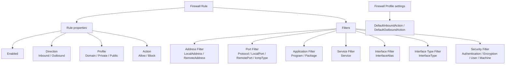
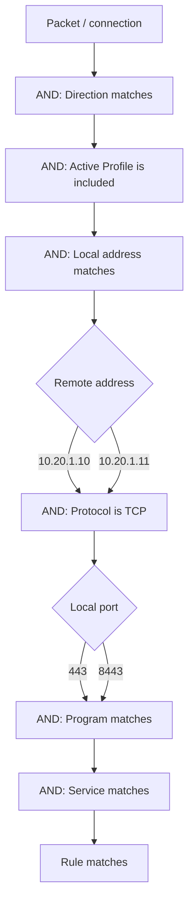
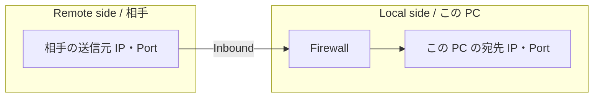
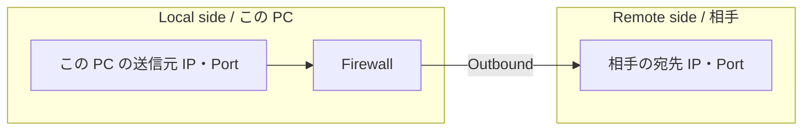
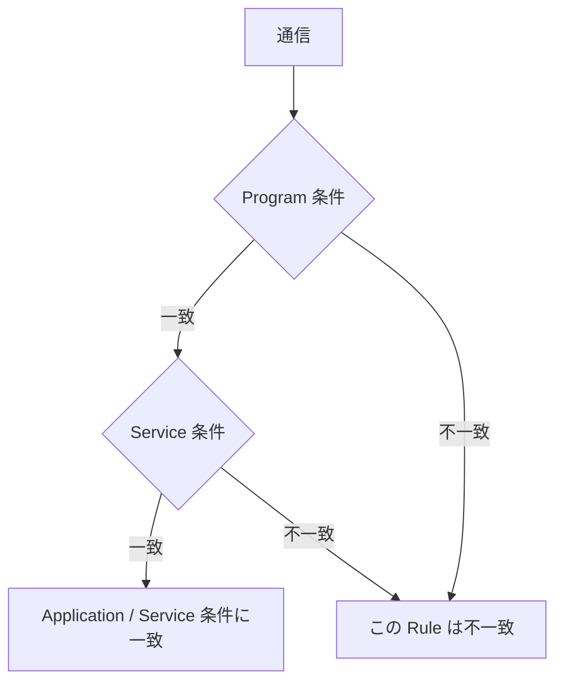
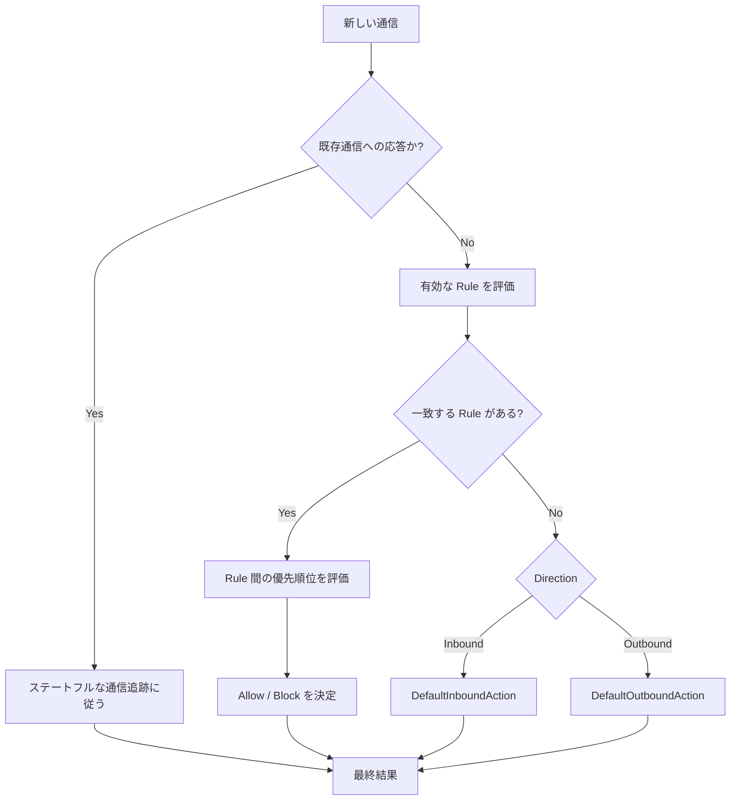

# Windows Firewall Rule の構造と通信判定

## Purpose

Windows Defender Firewall の Rule、Filter、Profile の関係と、通信に対する判定の考え方を説明する。

この文書では、`Get-NetFirewallRule` と関連する Filter 取得コマンドレットで参照できるローカル Firewall 設定を中心に扱う。Windows Filtering Platform（WFP）の内部実装を完全に説明するものではなく、Rule を読み解くための概念モデルを示す。

## 1. 全体像

Firewall Rule は、大きく **Rule の基本属性** と **通信のマッチング条件（Filter）** から構成される。

- Rule の基本属性は、通信方向、適用するネットワーク Profile、Rule の有効／無効、Action などを定義する。
- Filter は、通信のアドレス、Protocol／Port、Application、Service、Interface、Security などを条件として定義する。
- Profile 自体の既定動作（Default Inbound／Outbound Action）は、Rule とは別に Firewall Profile が持つ。



`Get-NetFirewallRule` で取得する Rule 本体には、アドレスや Port などの条件がすべて含まれるわけではない。これらは別の Filter オブジェクトとして取得する。NetSecurity では Rule と Filter の関連は 1 対 1 で管理される。

参照: [Get-NetFirewallRule](https://learn.microsoft.com/ja-jp/powershell/module/netsecurity/get-netfirewallrule?view=windowsserver2025-ps)

## 2. Rule 内の AND / OR

### 2.1 異なる条件どうしは AND

1つの Rule に指定した条件は、原則としてすべて満たす必要がある。Microsoft の `New-NetFirewallRule` の説明も、Rule のすべての criteria に一致したパケットに Action が適用されるとしている。

たとえば、次の条件を持つ Rule は、Direction、Profile、Address、Protocol／Port、Application、Service のすべてが一致した通信に適用される。

```text
Enabled
AND Direction = Inbound
AND Active Profile = Private
AND LocalAddress = 192.168.10.20
AND RemoteAddress ∈ 10.20.0.0/16
AND Protocol = TCP
AND LocalPort = 443
AND Program = C:\Apps\server.exe
AND Service = MyService
```

### 2.2 同じ条件に複数の候補がある場合は OR

同じ属性に複数の値を指定した場合は、そのうちのいずれかに一致すればよい。

例:

```json
{
  "LocalPort": ["443", "8443"],
  "RemoteAddress": ["10.20.1.10", "10.20.1.11"]
}
```

これは概念的には次の条件になる。

```text
(LocalPort = 443 OR LocalPort = 8443)
AND
(RemoteAddress = 10.20.1.10 OR RemoteAddress = 10.20.1.11)
```

したがって、Rule 全体では「異なる条件を AND で結び、同じ属性の複数候補を OR で結ぶ」と考えると読みやすい。



未指定または `Any` の条件は、その項目で通信を絞り込まない。実際の値や既定値の扱いは、各 Filter のプロパティと Windows のコマンドレット仕様に従う。

参照: [New-NetFirewallRule](https://learn.microsoft.com/en-us/powershell/module/netsecurity/new-netfirewallrule?view=windowsserver2025-ps)

## 3. Direction と Local / Remote は別の概念

`Direction` は、通信がこの PC に入ってくるか（Inbound）、この PC から出ていくか（Outbound）を表す。一方、`Local` と `Remote` は、Firewall を実行している PC と通信相手のどちら側かを表す。

- **Local**: Firewall を実行している PC 側
- **Remote**: 通信相手側

この意味は Inbound／Outbound で変わらない。変わるのは、通信の送信元・宛先としてどちらの側に当たるかである。

### Inbound（受信）



| Filter | 意味 |
|---|---|
| `RemoteAddress` | 相手 PC の送信元 IP |
| `RemotePort` | 相手 PC の送信元 Port（クライアントの動的 Port など） |
| `LocalAddress` | この PC の宛先 IP |
| `LocalPort` | この PC の受信 Port（Web Server の 443 など） |

### Outbound（送信）



| Filter | 意味 |
|---|---|
| `LocalAddress` | この PC の送信元 IP |
| `LocalPort` | この PC の送信元 Port（クライアントの動的 Port など） |
| `RemoteAddress` | 相手 PC の宛先 IP |
| `RemotePort` | 相手 PC の受信 Port（HTTPS の 443 など） |

同じ `LocalPort` でも、Inbound なら自 PC の受信 Port、Outbound なら自 PC の送信元 Port になる。`Local` が常に送信元、または常に宛先という意味ではない。

参照: [New-NetFirewallRule — LocalPort / RemotePort / LocalAddress / RemoteAddress](https://learn.microsoft.com/en-us/powershell/module/netsecurity/new-netfirewallrule?view=windowsserver2025-ps)

## 4. Profile はどのように決まるか

Rule の `Profile` は、その Rule をどのネットワーク Profile で有効にするかを指定する。通信相手の種類や Inbound／Outbound から決まるものではない。

Windows はネットワーク接続ごとに Network Category を持つ。`Get-NetConnectionProfile` は、ネットワーク アダプターに関連付けられた接続 Profile を返し、その `NetworkCategory` は次のいずれかになる。

| NetworkCategory | Firewall Profile | 意味 |
|---|---|---|
| `DomainAuthenticated` | Domain | ドメイン コントローラーを検出し、ドメイン認証されたネットワーク |
| `Private` | Private | 自宅や信頼できる職場ネットワークなど |
| `Public` | Public | 空港、ホテル、公衆 Wi-Fi など。未識別ネットワークの既定値 |

Domain はドメイン認証に基づいて自動判定され、`Set-NetConnectionProfile` で手動設定するものではない。Private／Public はネットワーク接続のカテゴリとして設定できる。

Rule の `Profile` が `Private` の場合、その通信に使われるネットワーク接続の Profile が Private のときに Rule の適用候補になる。`Profile` が複数指定されていれば、そのいずれかが対象となる。

注意: PC に複数のネットワーク アダプターがある場合、接続ごとに異なる Network Category が存在し得る。Profile を PC 全体で常に1つだけの状態として理解しないこと。

Profile と Interface 条件も別である。

- `Profile`: ネットワークの場所・カテゴリ（Domain / Private / Public）
- `InterfaceAlias`: どのネットワーク アダプターを通る通信か
- `InterfaceType`: 有線／無線／RemoteAccess など、インターフェースの種類

それぞれが指定されていれば、Rule の他の条件と合わせて評価される。

参照:

- [Windows Firewall overview — Firewall profiles](https://learn.microsoft.com/en-us/windows/security/operating-system-security/network-security/windows-firewall/)
- [Get-NetConnectionProfile](https://learn.microsoft.com/en-us/powershell/module/netconnection/get-netconnectionprofile)
- [Set-NetConnectionProfile](https://learn.microsoft.com/en-us/powershell/module/netconnection/set-netconnectionprofile)
- [New-NetFirewallRule — Profile](https://learn.microsoft.com/en-us/powershell/module/netsecurity/new-netfirewallrule?view=windowsserver2025-ps)

## 5. Application と Service

Application Filter と Service Filter は、異なる対象を識別する条件である。

| Filter | プロパティ | 識別対象 |
|---|---|---|
| Application | `Program` | 実行ファイルの完全パス |
| Application | `Package` | パッケージ化された Windows アプリの Package SID |
| Service | `Service` | Windows Service の短いサービス名 |

`Program` は「どの実行ファイルか」、`Service` は「その通信をどの Windows Service として行っているか」を絞り込む。`svchost.exe` のように複数サービスをホストする実行ファイルでは、Service 条件を加えて特定サービスに限定できる。

両方が指定されている場合は、同じ通信が Program 条件と Service 条件の両方を満たす必要がある。Program だけを指定した場合は実行ファイルで、Service だけを指定した場合はサービス名で絞り込む。Service が指定されていない場合、Service 条件は特定サービスに限定しない。



これは Filter 条件の概念図であり、Windows のアプリケーション識別やサービス識別の内部実装を表すものではない。Application identity は Windows Filtering Platform の Application Layer Enforcement（ALE）で扱われる。

参照:

- [Get-NetFirewallApplicationFilter](https://learn.microsoft.com/en-us/powershell/module/netsecurity/get-netfirewallapplicationfilter?view=windowsserver2025-ps)
- [Get-NetFirewallServiceFilter](https://learn.microsoft.com/en-us/powershell/module/netsecurity/get-netfirewallservicefilter?view=windowsserver2025-ps)
- [New-NetFirewallRule — Program / Package / Service](https://learn.microsoft.com/en-us/powershell/module/netsecurity/new-netfirewallrule?view=windowsserver2025-ps)
- [Application Layer Enforcement (ALE)](https://learn.microsoft.com/en-us/windows/win32/fwp/application-layer-enforcement--ale-)

## 6. Rule が一致した後の Action と、既定動作

Rule の条件が一致すると、その Rule の `Action`（Allow / Block）が通信に対して適用される。ただし、複数の Rule が同じ通信に一致することがあるため、単純に「最初に一致した Rule が勝つ」という仕組みではない。

Microsoft が説明する主な優先順位は次のとおり。

1. 明示的な Allow Rule は、既定の Block より優先される。
2. 明示的な Block Rule は、競合する Allow Rule より優先される。
3. 明示的な Block が競合していない場合、より具体的な Rule が、より広い Rule より優先される。
4. Windows Firewall は、管理者が指定した重み付きの Rule 順序をサポートしない。

さらに `OverrideBlockRules` を使った認証済みバイパス Rule は例外で、別の IPsec Rule による認証を条件として、通常なら Block される通信を許可できる。

### すべての Rule に一致しない場合

新しい通信がどの有効な Rule にも一致しなければ、該当する Firewall Profile の既定動作に従う。

| Profile 設定 | Rule 不一致時の既定動作 |
|---|---|
| `DefaultInboundAction = Block` | Inbound を Block |
| `DefaultInboundAction = Allow` | Inbound を Allow |
| `DefaultOutboundAction = Allow` | Outbound を Allow |
| `DefaultOutboundAction = Block` | Outbound を Block |

Windows の標準的な既定値は **Inbound = Block、Outbound = Allow** である。ただし、実際の値はローカル設定や GPO などのポリシーによって変更され得るため、`Get-NetFirewallProfile` の値を確認する。



Windows Firewall はステートフルである。たとえば、内部 PC から開始した TCP 接続に対する応答パケットは、その接続状態に一致すれば、通常は新規の Inbound Allow Rule がなくても通過できる。したがって、単純な「各パケットを独立して Rule と照合する」モデルだけでは実際の挙動を説明しきれない。

参照:

- [Windows Firewall overview — default behavior](https://learn.microsoft.com/en-us/windows/security/operating-system-security/network-security/windows-firewall/)
- [Windows Firewall Rules — rule precedence](https://learn.microsoft.com/ja-jp/windows/security/operating-system-security/network-security/windows-firewall/rules)
- [Set-NetFirewallProfile — DefaultInboundAction / DefaultOutboundAction](https://learn.microsoft.com/en-us/powershell/module/netsecurity/set-netfirewallprofile?view=windowsserver2025-ps)
- [New-NetFirewallRule — OverrideBlockRules](https://learn.microsoft.com/en-us/powershell/module/netsecurity/new-netfirewallrule?view=windowsserver2025-ps)
- [Application Layer Enforcement (ALE) — stateful filtering](https://learn.microsoft.com/en-us/windows/win32/fwp/application-layer-enforcement--ale-)

## 7. PSNetRules の管理対象との関係

PSNetRules は `PersistentStore` の Firewall Rule をすべて Desired State として管理するわけではない。`capture` は現在の Rule と7種類の関連 Filter を Snapshot に保存し、同じ Name を持つ `SystemDefaults` の Rule と比較する。

比較対象は Rule 本体と7種類の Filter の CIM プロパティである。Name、InstanceID、PolicyStore とその由来情報、実行時の状態情報、CIM メタデータは比較対象から除外する。

| `diff` の Status | 意味 |
|---|---|
| `DefaultExcluded` | 同じ Name の `SystemDefaults` Rule と比較対象プロパティが完全一致する未採用 Rule。 |
| `NewCandidate` | `SystemDefaults` に同じ Name がない、または同名 Rule と一致しない未採用 Rule。 |
| `ComparisonInconclusive` | 比較情報が不足し、既定 Rule との一致を確定できない Rule。 |
| `InSync` / `Modified` | Desired State に採用済みの Rule が Snapshot と一致する / 異なる状態。 |
| `Missing` | Desired State に採用済みの Rule が最新 Snapshot に存在しない状態。 |
| `Rename` | `Missing` と `NewCandidate` の Rule が Name 以外のプロパティで一意に対応する状態。 |
| `DeletePending` / `DeleteComplete` | 採用済み Name が Desired State から削除され、Snapshot には存在する / 既に存在しない状態。 |
| `Excluded` / `ExcludedMissing` | 明示的な管理除外 Rule が Snapshot に存在する / 存在しない状態。 |

未採用 Rule は `adopt` で明示的に採用する。一度採用された Rule は、後に `SystemDefaults` と完全一致しても管理対象のままである。管理状態は `network-rules.json` の Desired State と State sidecar の `managedFirewallRules` で保持し、既定 Rule との一致状態とは分離する。

管理を終了する場合は `unmanage -Name` を使用する。選択した Name を `firewallRules` と `managedFirewallRules` から削除し、`network-rules.json` の `excludedFirewallRules` に記録する。未採用の `NewCandidate` も最新 Snapshot に存在すれば除外できる。除外した Rule は、存在中は `Excluded`、後の Snapshot から消えた場合も除外記録が残る限り `ExcludedMissing` となる。除外 Rule は `NewCandidate` に戻らず、`generate` の削除対象にもならない。再び管理する場合は `adopt -Name` で採用し、除外記録を解除する。

Desired State から採用済み Rule を直接削除し、State sidecar の Name を残すと `DeletePending` になる。これは `generate` で Windows Rule を削除する意思表示であり、Windows Rule を残したまま管理対象から外す `unmanage` とは異なる。

Name だけが変更された Rule は、`Missing` と `NewCandidate` の Rule を Name 以外のプロパティで比較して検出する。旧 Rule と新 Rule の双方で対応先が一意な 1 対 1 の場合だけ `Rename` と分類する。曖昧な対応関係は `Missing` / `NewCandidate` のまま残る。`adopt -Rename` は新しい Name を Desired State と State sidecar に受け入れる操作であり、Snapshot や Windows Firewall は変更しない。個別に受け入れる場合は `adopt -Rename -Name '<old-name>'` を使用する。

各 PolicyStore の役割は次のとおり。

- `PersistentStore`: ローカルの永続 Rule 設定。PSNetRules が採用済み Rule を変更する対象。
- `SystemDefaults`: 同名 Rule の既定設定を比較する基準。
- `ActiveStore`: GPO などを含む、有効なポリシーの統合結果。PSNetRules の Rule 由来判定には使用しない。

Firewall Profile、Dynamic Keyword Address、ローカル NRPT Rule は Firewall Rule と異なり、JSON の各コレクション全体を Desired State として扱う。この管理 JSON は GPO を含む `ActiveStore` 全体の表現ではない。

PSNetRules 自身は Windows Firewall や NRPT を直接変更しない。`generate` が Desired State と Snapshot から確認可能な PowerShell スクリプトを生成する。管理者が内容を確認して実行した後、再度 `capture` と `diff` で結果を確認する。

### Snapshot / State sidecar のスキーマ

`network-rules.snapshot.json` と `network-rules.state.json` は、それぞれ `schemaVersion: 1` を使用する。Snapshot の `configuration` は Desired Configuration と同じ v1 構造であり、`comparison` の各プロパティ値は `{ "Value": ... }` として保持する。比較用の Canonical JSON は Snapshot に保存せず、比較時に必要な複合値について生成する。

State は `schemaVersion`、NRPT の論理 ID と Windows Name の対応を保持する `nrptRules`、管理対象 Firewall Rule Name の配列 `managedFirewallRules` で構成する。読み込み・書き込みはこの v1 形式を前提とし、別形式の sidecar の変換や読み替えは行わない。

JSON Schema は `schema/snapshot.schema.json` と `schema/state.schema.json` に定義する。Desired Configuration のスキーマは `schema/network-rules.schema.json` を参照する。

## 8. 要点

- Rule の異なる条件は原則 AND、同じ属性の複数候補は OR として読む。
- Direction と Local / Remote は別概念。Local は常に Firewall を実行する PC 側。
- Profile はネットワーク接続のカテゴリに対応し、Rule の適用対象を決める。
- Application は実行ファイル／パッケージ、Service は Windows Service を識別する。両方を指定すれば両方の条件が必要。
- Rule 間は先勝ちではない。明示 Block、Rule の具体性、認証済みバイパスなどの優先順位がある。
- どの Rule にも一致しない新しい通信は、Profile の DefaultInboundAction / DefaultOutboundAction に従う。標準的な既定値は Inbound Block、Outbound Allow。
- 既存接続への応答はステートフルな通信追跡の対象であり、新しい通信と同じようには扱わない。
